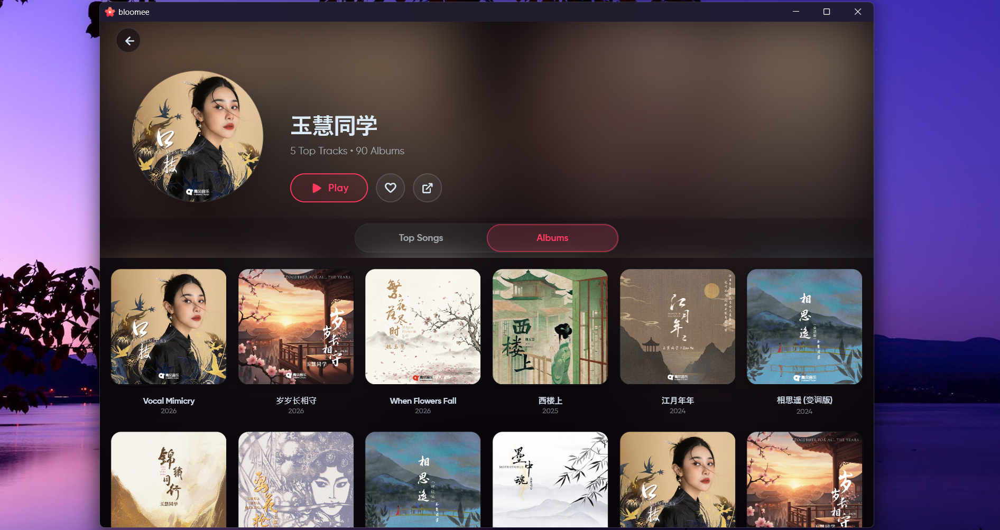

# Ragam

### Your music. Your sources. Your circle.

**A refined, open-source music player built on the strong foundation of BloomeeTunes.**

<br>

[](https://flutter.dev)
[](https://www.rust-lang.org)
[](LICENSE)

</div>

---

## 🎵 What is Ragam?

**Ragam** is a redefined Bloomee-based music experience focused on freedom, shared listening, and a more personal home-screen experience. It combines local audio, plugin-powered streaming, and real-time synchronization into one polished cross-platform player.

Ragam keeps the core philosophy that made Bloomee special: no ads, no locked sources, and complete control over how you listen.

---

## ✨ Ragam features

### Listening together

- **Party Rooms** — Host a room and invite friends with a short room code.
- **Host approval** — Guests require approval before joining a party.
- **Synchronized playback** — Tracks, play/pause state, seeking, and playback are synchronized across devices.
- **Drift compensation** — Keeps participating devices aligned during shared listening sessions.
- **Flexible connectivity** — Use the included community relay or configure your own Supabase project.

### Music and discovery

- Play local device music alongside online streams.
- Browse music through the secure, Rust-backed plugin system.
- Search, playlists, artist and album views, and personalized discovery.
- Receive plugin updates and new music sources automatically.
- Offline downloads with smart stream recovery.

### Android home-screen experience

- A dedicated Ragam music player widget.
- Live artwork, track title, artist, progress, and playback state.
- Widget controls for play/pause, previous, next, rewind, and forward.
- Direct seeking from the widget.

### Personalization and integrations

- Karaoke-style, time-synced lyrics with manual offset control.
- Equalizer and customizable crossfade.
- Last.fm scrobbling with offline caching.
- Discord Rich Presence.
- Android notifications and native media controls.
- Global charts supplied by installed plugins.
- Backup and restore through JSON and M3U.
- AI-assisted recommendations powered by available plugins and Last.fm.

### Built for more than one language

Ragam includes localized interfaces for:

| Language | Native name |
| -------- | ----------- |
| English  | English     |
| Hindi    | हिन्दी      |
| Korean   | 한국어      |
| German   | Deutsch     |
| Spanish  | Español     |
| Japanese | 日本語      |
| Chinese  | 中文        |

---

## 📱 Supported platforms

- **Android**
- **Windows**
- **Linux** _(development build)_

---

## 🖼️ Screenshots

<div align="center">
  
  
  <br>
  
  
</div>

---

## 🔄 Listen Together setup

1. Open **Sync & Database** in Ragam settings.
2. Set a recognizable device name.
3. Start a party room from the player.
4. Share the generated room code with another listener.
5. Approve the guest request on the host device.

To use your own infrastructure, enable **Custom Supabase** in Sync settings and enter your Supabase project URL and anonymous key. Ragam will test the connection before saving it.

---

## 🛠️ Build from source

### Prerequisites

- Flutter SDK compatible with the version in `pubspec.yaml`
- Dart SDK
- Platform tooling for Android, Windows, or Linux
- Rust and Cargo for native plugin/Rust components

### Run Ragam

```sh
git clone <your-ragam-repository-url>
cd <ragam-directory>
flutter pub get
flutter run
```

For platform-specific builds:

```sh
flutter build apk
flutter build windows
flutter build linux
```

---

## 🤝 Contributing

Contributions are welcome. Please keep changes focused, run analysis and tests, and follow the existing Flutter and BLoC architecture.

- Open an issue before starting a major feature.
- Create a focused pull request.
- Add tests for synchronization or playback behavior where possible.

Please read [CONTRIBUTING.md](CONTRIBUTING.md) before submitting changes.

---

## 🙏 Credits

Ragam is a fork and reimagining of **[BloomeeTunes](https://github.com/HemantKArya/BloomeeTunes)**, created and maintained by **Hemant Karya** and the Bloomee community.

The Ragam name, branding, Listen Together synchronization, Android widget, and project-specific enhancements belong to the Ragam project. The core architecture, player foundation, plugin system, and many of the features above come from BloomeeTunes and remain subject to its license and upstream contributors.

Huge thanks to the original Bloomee author and every Bloomee contributor who laid the foundation for this project. 🌸

---

## ⚖️ License

Ragam is distributed under the license included in this repository. See [LICENSE](LICENSE) for details.

If you redistribute Ragam, retain the upstream and contributor credit notices required by the applicable license.

---

**Made for a more connected listening experience.**

<i>Built with inspiration from BloomeeTunes.</i>
